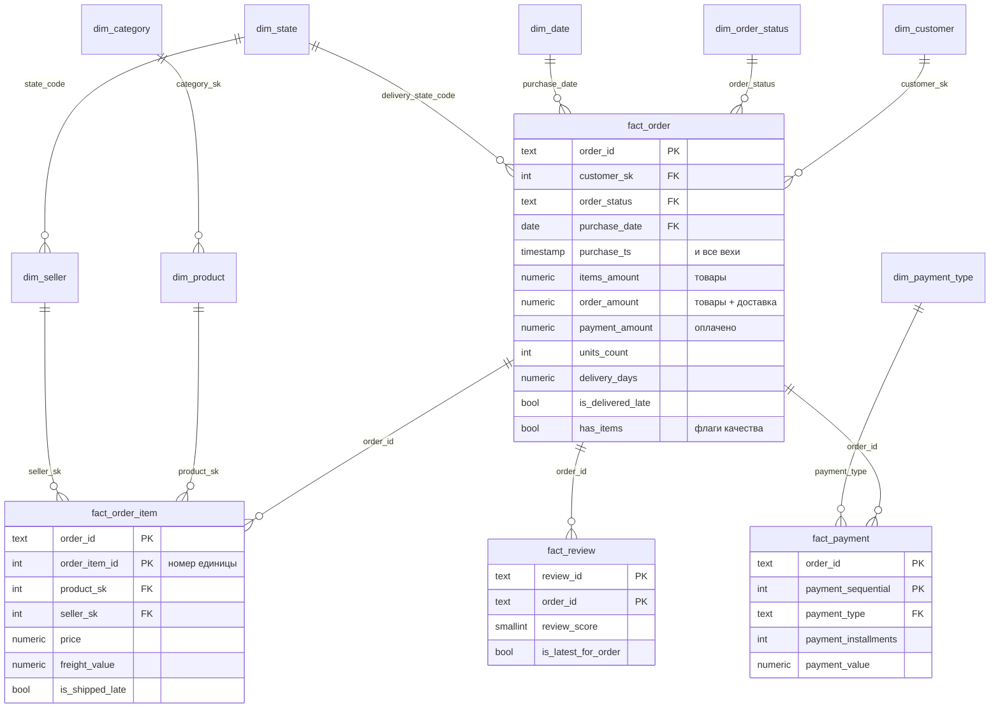

# 1. Схема и код

Скрипт, который собирает модель из `raw` с нуля на чистой базе.

```bash
make build                    # = bash scripts/build_model.sh
```

Файлы выполняются по порядку имён **одной транзакцией**. Если падает любой шаг
или не проходит самопроверка уровня `error`, транзакция откатывается целиком,
и в базе остаётся прежняя рабочая версия модели. Повторный запуск даёт тот же
результат: сборка идемпотентна. На текущих данных занимает около 30 секунд.

| Файл | Что делает |
|---|---|
| [`00_schemas.sql`](00_schemas.sql) | Пересоздаёт схемы `stg`, `core`, `mart`, `dq`. `raw` не трогает |
| [`10_stg.sql`](10_stg.sql) | ODS: типизация, trim, нормализация городов и индексов, дедупликация по натуральному ключу |
| [`20_core_dimensions.sql`](20_core_dimensions.sql) | Измерения и справочники с бизнес-правилами |
| [`30_core_facts.sql`](30_core_facts.sql) | Четыре факта, внешние ключи |
| [`40_mart.sql`](40_mart.sql) | Витрина дашборда `v_delivery`, агрегат-гистограмма `agg_delivery_hist`, каталог метрик `metric_catalog` |
| [`90_dq.sql`](90_dq.sql) | 39 самопроверок; провал проверки уровня `error` откатывает сборку |

## Слои

```
raw  ──►  stg (ODS)  ──►  core (звезда)  ──►  mart (витрины, метрики)
 text      типы, чистка,     ключи, FK,          только из core
           дедупликация      флаги, COMMENT
                                 │
                                 └──►  dq.check_result (сверки raw ↔ core)
```

После сборки `core` не зависит от `raw` и `stg`: это физические таблицы.

## Схема core



## Факты: зерно и ключи

| Таблица | Зерно | Ключ | Строк |
|---|---|---|---|
| `fact_order` | заказ (накопительный снимок: вехи, длительности, суммы, флаги) | `order_id` | 99 441 |
| `fact_order_item` | **одна единица товара**: два одинаковых товара в заказе — две строки | `(order_id, order_item_id)` | 112 650 |
| `fact_payment` | платёж | `(order_id, payment_sequential)` | 103 886 |
| `fact_review` | отзыв на заказ | `(review_id, order_id)`: `review_id` не уникален | 99 224 |

Суммы позиций и платежей агрегируются по заказу **по отдельности** и только потом
присоединяются к `fact_order`. Прямой JOIN позиций с платежами размножает строки
(N × M) и завышает суммы.

## Измерения

| Таблица | Ключ | Натуральный ключ | Особенности |
|---|---|---|---|
| `dim_date` | `calendar_date` | — | 2016–2020; отчёты по месяцам строятся от календаря, поэтому пустой ноябрь 2016 не теряется |
| `dim_customer` | `customer_sk` | `customer_unique_id` | Покупатель-человек. `customer_id` источника выдаётся на каждый заказ и ключом быть не может |
| `dim_seller` | `seller_sk` | `seller_id` | Город нормализован, исходное написание в `city_raw` |
| `dim_product` | `product_sk` | `product_id` | Габариты, объём; цена — не атрибут товара |
| `dim_category` | `category_sk` | `category_code` | `0` — без категории (610 товаров), `-1` — неизвестно; запасной перевод |
| `dim_order_status` | `order_status` | — | Флаги `is_revenue`, `is_cancelled`, `is_final`: правило выручки живёт здесь |
| `dim_payment_type` | `payment_type` | — | `not_defined` — отдельный член |
| `dim_state` | `state_code` | — | 27 штатов и макрорегионы |

Член **«неизвестно» (`-1`)** есть в каждом измерении с суррогатным ключом. Если
новая порция данных сошлётся на товар, которого нет в справочнике, позиция не
пропадёт на JOIN, а уйдёт на `-1`, и это покажет проверка `I01`.

Неизвестное значение справочника с правилами (новый статус, тип оплаты, штат)
добавляется автоматически с `is_documented = false`. Сборка не падает, проверка
`I03` предупреждает.

## Как модель обращается с проблемами данных

Строки не выбрасываются молча: аномалия становится флагом, и аналитик сам решает,
фильтровать ли её.

| Проблема | Где видна |
|---|---|
| 775 заказов без позиций | `fact_order.has_items = false` |
| 1 заказ без платежа | `fact_order.has_payment = false` |
| 366 заказов: оплачено ≠ товары + доставка | `fact_order.is_payment_mismatch` |
| 189 заказов с невозможной хронологией | `fact_order.is_chronology_broken`; длительности этапов = NULL |
| 8 `delivered` без даты вручения, 6 отменённых с датой | `is_delivered_without_date`, `is_cancelled_with_delivery` |
| 4 позиции со сроком отгрузки в 2020 году | `fact_order_item.is_shipping_limit_suspicious` |
| Нераспознанные даты и числа в будущих порциях | NULL в `stg` и счётчик в `dq` (`P01`–`P04`) |
| Дубликаты в будущих порциях | Дедупликация в `stg`, счётчик `P05` |

## Самопроверки (`dq.check_result`)

```bash
make dq
```

* `R01–R11` — сверка `raw ↔ core`: число строк и суммы денег совпадают до копейки.
* `C01–C06` — согласованность внутри `core`: суммы заказа = суммам позиций и платежей,
  выручка по категориям = общей выручке.
* `P01–P05` — нераспознанные значения и снятые дубликаты.
* `I01–I04` — ссылки на «неизвестно» и неописанные значения справочников.
* `B01–B10` — известные особенности данных; изменение числа подсказывает, что пришло новое.
* `M01–M03` — витрины `mart` согласованы с `core`; медианы из гистограммы равны прямому расчёту.

## Время

Таймстемпы хранятся как `timestamp` **без часового пояса**: в источнике его нет,
это местное время Сан-Паулу. Перевод в `timestamptz` с серверной зоной UTC
сдвинул бы ночные заказы через границу месяца, и помесячная выручка разошлась бы.
